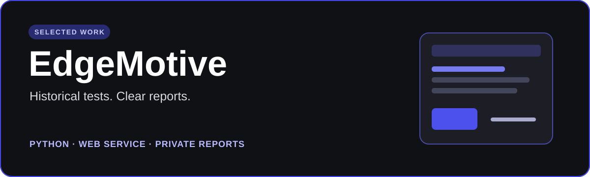
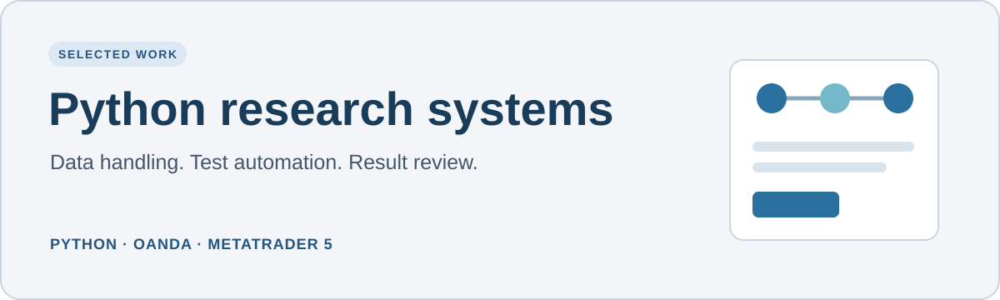

# Mustapha Ibrahim

**Software developer · Python systems · Ottawa, Canada**

I build Python software for research, automation, and web services. Since 2022, my work has focused on historical testing tools and a hosted service that turns complex test results into clear reports.

## Selected projects

**EdgeMotive** is a hosted service for repeatable historical strategy tests and private reports. I built its Python service, data checks, report workflow, account features, and deployment. [Explore the live product](https://backtest.software/) · [Read the project overview](projects/edgemotive.md)

**Python research systems** are tools I built for historical data handling, automated testing, and result review across OANDA and MetaTrader 5. [Read the project overview](projects/research-systems.md)

## Tools

Python · pandas · NumPy · SQL · Git · REST APIs · AWS · Linux · Railway

I am happy to discuss the engineering work and design decisions behind these projects in an interview.
